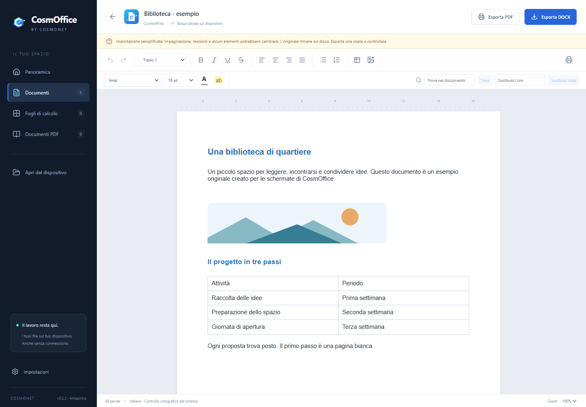
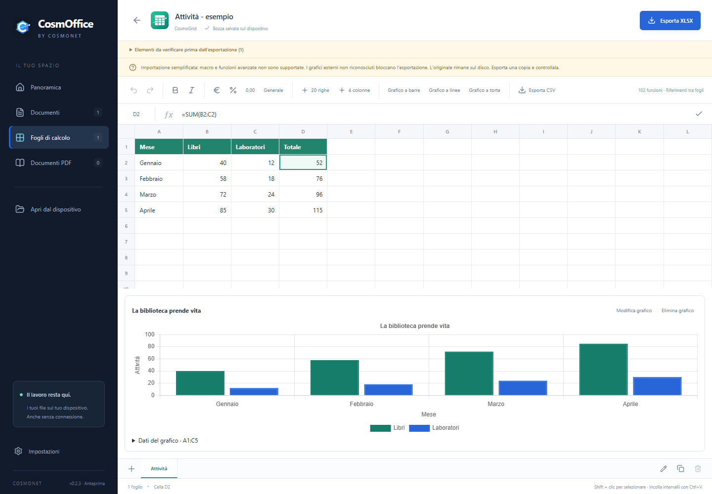
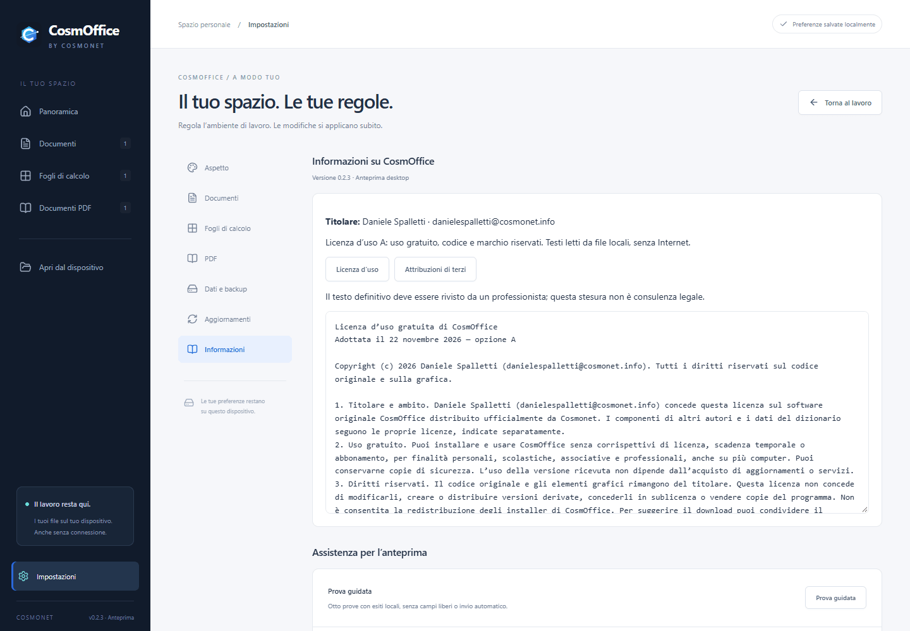
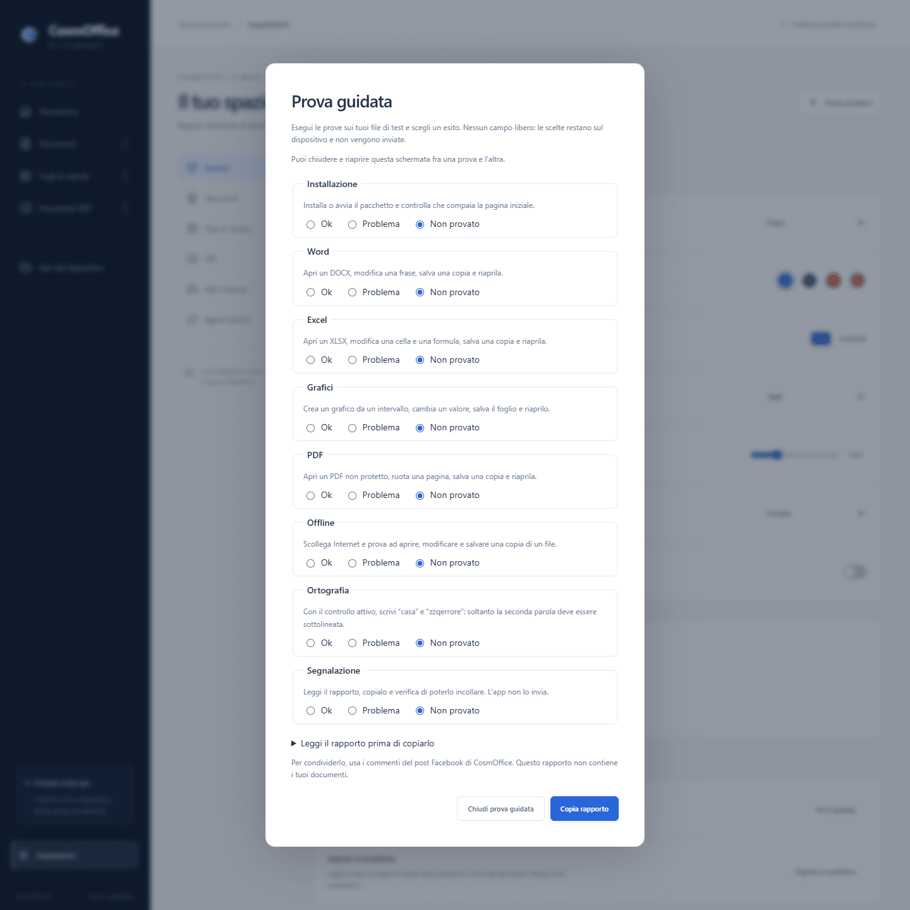
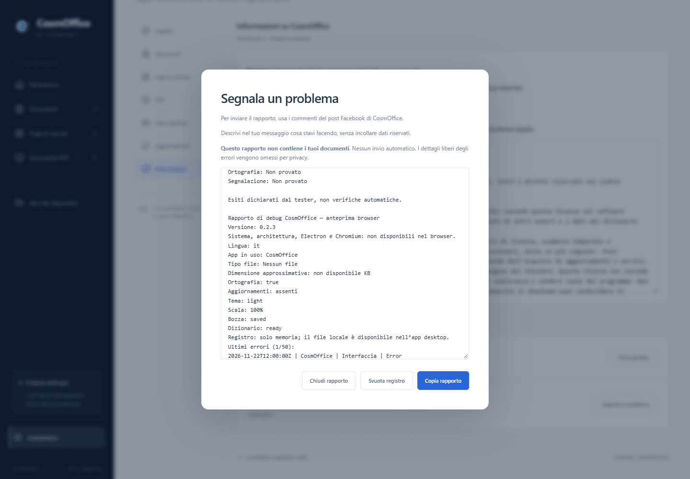

# CosmOffice

Suite desktop gratuita, offline e in italiano di Cosmonet: **CosmoWrite**, **CosmoGrid** e **CosmoView**.

**CosmOffice 0.2.3 (anteprima).** È una prima implementazione funzionante, con un sottoinsieme delle funzioni Office. Non è ancora un sostituto completo di Microsoft Office. Android e iOS sono pianificati, non implementati.

Installer ufficiali e checksum nella pagina [Release](https://github.com/CosmoNetinfo/CosmOffice/releases/latest). La pubblicazione 0.2.3 è autorizzata dal titolare; esiti e disponibilità effettiva sono nel [report corrente](docs/report/ULTIMO.md). Gli installer 0.2.2 restano immutati. **Chi ha la 0.2.2 aggiorna manualmente una volta**; chi ha già una build di prova 0.2.3 deve installare a mano la Release dello stesso numero. Poi il pulsante degli aggiornamenti cerca le future versioni superiori pubblicate. Nessun collaudo su PC fisico pulito viene dedotto dall’autorizzazione al rilascio. Le funzioni documentali continuano a lavorare senza Internet.


## Priorità attuale: compatibilità e affidabilità

La versione 0.2.1 consolida apertura, modifica essenziale e salvataggio di DOCX, XLSX e PDF. Grafici essenziali sono ora inclusi in CosmoGrid; presentazioni, macro e nuove funzioni distintive restano per una fase successiva.

- Le esportazioni Excel lavorano su una copia, senza modificare la cartella aperta. Celle unite, formule condivise, date, collegamenti e immagini sono inclusi nei test di conservazione.
- Se la bozza non si salva, il documento rimane aperto e il cambio schermata è bloccato fino al recupero; è possibile riprovare o esportare una copia prima della chiusura.
- DOCX/XLSX vengono controllati prima della conversione. I PDF non protetti vengono letti dal motore prima di entrare nell’archivio; quelli protetti vengono sbloccati nel lettore.
- I file con commenti/note, revisioni, grafici, pivot, macro, oggetti incorporati o collegamenti esterni mostrano avvisi specifici quando queste parti sono rilevate. Il controllo non garantisce di riconoscere ogni possibile incompatibilità.
- Il ripristino di un backup è atomico e ne conserva gli avvisi di compatibilità. Un errore di esportazione su disco non deve sostituire il file di destinazione con dati incompleti.

La 0.2.2 aggiunge la conservazione degli zeri iniziali e dei codici lunghi, il rispetto delle celle in formato testo e la distinzione tra testo simile a errori (ad esempio `#N/A`) ed errori effettivi di calcolo. I valori fuori dalla precisione numerica supportata vengono conservati come testo invece di arrotondarli implicitamente. Il limite delle 15 cifre in Excel è documentato dal [supporto Microsoft](https://support.microsoft.com/en-us/excel/keeping-leading-zeros-and-large-numbers).

Un controllo indipendente opzionale apre e risalva i campioni con LibreOffice (`DOCX → ODT → DOCX`, `XLSX → ODS → XLSX`) e verifica un PDF prodotto da quel motore. Non richiede LibreOffice per usare CosmOffice: serve solo ai test. La prova copre un corpus ristretto e non certifica Microsoft Office.

## File Markdown (.md)

Nella 0.2.3, **Nuovo Markdown** crea appunti in CosmoWrite. **Apri un file** legge i `.md` UTF-8: testo sorgente modificabile e anteprima offline con titoli, enfasi, elenchi, tabelle e blocchi di codice. **Esporta MD** salva una copia; la bozza e i backup mantengono il formato Markdown. Ctrl+S esporta il file.

L’anteprima non scarica immagini, non apre link e non esegue HTML attivo. Immagini e collegamenti restano nel sorgente, ma le immagini non sono mostrate; non ci sono conversione DOCX/PDF, ortografia o barra di formattazione per Markdown. Formule matematiche ed estensioni non interpretate restano nel file. Oltre 200.000 caratteri l’anteprima viene sospesa, mentre modifica e salvataggio restano disponibili, entro il limite di apertura di 50 MB. UTF-8 non valido viene rifiutato. Senza modifiche si conservano BOM e terminatori originali; dopo modifiche il campo di testo usa terminatori LF.

## Cosa funziona

- CosmoWrite: scrittura, font/dimensioni/colori/evidenziatore, titoli, allineamento, elenchi, tabelle, immagini con proporzioni conservate (incluso WebP convertito), annulla/ripristina, trova/sostituisci. Importazione DOCX/TXT/HTML, recupero dei principali stili OOXML, esportazione DOCX e PDF desktop, stampa, A4/Letter, orientamento, margini e interlinea.
- CosmoGrid: XLSX, importazione/esportazione CSV e TSV con virgolette/testo multilinea/decimali italiani, 102 funzioni abilitate, riferimenti tra fogli (anche nomi con spazi), formule condizionali e ricerche, selezione con Shift+clic, copia/incolla di intervalli, annulla/ripristina, formati numerici, rinomina/duplica/elimina fogli. Grafici a barre, linee e torta da intervalli selezionati, aggiornati con i dati e salvati come grafici nativi XLSX. La rinomina aggiorna i riferimenti espliciti al foglio.
- CosmoView: PDF offline, pagine, zoom, rotazione persistente della pagina selezionata, selezione testo, ricerca per pagine, password, ultima pagina ricordata e stampa delle pagine renderizzate. Senza modifiche la copia è identica all’originale. Non esegue script o azioni dei documenti.
- Impostazioni complete: tema chiaro/scuro/sistema, accento anche HEX personalizzato, scala 80–150%, densità, barra laterale, preferenze degli editor, aggiornamenti su richiesta, Informazioni con licenza locale, backup/ripristino dell’archivio, esportazione/importazione delle preferenze JSON e svuotamento con conferma. Nessuna voce è un controllo dimostrativo.
- Bozze e file PDF conservati localmente in IndexedDB, riapertura dall’archivio, ricerca, rinomina ed eliminazione delle copie locali.
- File originali conservati: l’esportazione chiede dove salvare la copia.
- Nessun account o telemetria; font, decoder PDF e lessico italiano Morph-it! inclusi nel pacchetto. Nel main l’unica rete è il controllo aggiornamenti su richiesta dalle impostazioni, spento di default: solo Release del progetto e relativi file, tramite TLS Node. Disattivandolo nessuna richiesta; renderer e API generali Node/Electron restano bloccati. Il controllo ortografico italiano di CosmoWrite e CosmoGrid usa dati locali e parole personali; Hunspell nativo rimane disabilitato per impedirne i download automatici.

Il dizionario italiano comprende 400.680 forme distinte derivate da Morph-it! 0.4.8 di Marco Baroni ed Eros Zanchetta, distribuite separatamente sotto CC BY-SA 2.0. Attribuzione, licenza completa, sorgente compresso e parole sono in `public/dictionaries/` e nel pacchetto. `node scripts/italian-dictionary.mjs` rigenera le parole dal sorgente incluso senza rete. Non offre grammatica, suggerimenti o altre lingue; termini validi assenti dal lessico possono essere sottolineati. Le parole personali restano in localStorage su questo dispositivo, separate dai documenti; non sono incluse nei backup dei documenti o nell'esportazione delle preferenze.

## Compatibilità: limiti espliciti

L’importazione Word ricostruisce il corpo; non riproduce fedelmente paginazione e stili complessi. Intestazioni e piè di pagina di documenti a sezione singola vengono conservati nel DOCX esportato con le rispettive immagini e relazioni, ma non sono visualizzati o modificabili nell’editor. Esportazione bloccata per sezioni multiple con intestazioni, numerazione complessa nelle intestazioni e contenuti rilevati come non supportati (commenti, note, revisioni, grafici, oggetti incorporati): la bozza e l’originale restano disponibili. Il rilevamento non copre ogni oggetto possibile. Esportare e confrontare sempre una copia per documenti importanti. I principali stili dei paragrafi e del testo vengono recuperati dall’OOXML quando il contenuto può essere associato senza perdita. Immagini e strutture complesse mantengono la conversione strutturale di Mammoth. Le dimensioni delle immagini esportate conservano le proporzioni; WebP viene convertito localmente in PNG.

I fogli preservano i dati fuori dall’area visibile, ma non garantiscono la conservazione di ogni oggetto Excel. Macro, grafici esterni non riconosciuti, pivot, riferimenti a cartelle esterne, nomi definiti, formule matriciali dinamiche, formati DOC/XLS/XLSM, spostamento relativo delle formule copiate e fogli enormi non sono supportati. Le 102 funzioni abilitate non equivalgono al motore completo Excel: formule finanziarie, casi limite di date/criteri e cartelle complesse richiedono ulteriore verifica. Gli intervalli incollati sono testo tabulato; le formule vengono inserite come scritte, senza traslazione dei riferimenti. I CSV importati trattano le stringhe che iniziano con “=” come testo, per evitare l’esecuzione implicita di formule. Le formule non riconosciute mostrano un errore e non usano risultati memorizzati obsoleti. Excel è invitato a ricalcolare le formule all’apertura.

Il visualizzatore PDF permette soltanto la rotazione persistente di una pagina per volta; non modifica testo o immagini, non esegue OCR su scansioni e non offre ancora firma, annotazioni o compilazione moduli. La rotazione aggiorna la bozza ed è inclusa nella copia salvata. I PDF cifrati e quelli con firme o campi firma rilevati non vengono modificati: resta possibile salvare la copia originale. Il rilevamento non certifica la validità delle firme. La ricerca trova le pagine che contengono il testo. La stampa PDF è rasterizzata per pagina, adatta alla lettura e limitata a 100 pagine; il salvataggio conserva invece i contenuti PDF originali senza rasterizzarli. Per la rotazione si usa [pdf-lib 1.17.1, licenza MIT](https://github.com/Hopding/pdf-lib/blob/v1.17.1/LICENSE.md), incluso nel pacchetto offline.

I backup .cosmoffice contengono fino a 48 MB di contenuti e vengono ripristinati come nuove copie in una transazione locale. Sono esclusi password e preferenze; queste ultime si esportano separatamente. Le bozze locali non sostituiscono un backup. L’apertura dei file è limitata a 50 MB. L’interfaccia si adatta anche a schermi stretti; ciò non equivale a un’app Android/iOS.

## Avvio locale

Richiede Node.js 24 e npm.

```sh
npm ci
npm run icons
node scripts/pdf-assets.mjs
npm run dev
```

`npm run dev` compila e avvia Electron da file locali, senza server; per aggiornare il codice riavvia il comando. Per usare solo l’anteprima di sviluppo nel browser: `npm run dev:web` avvia un server locale destinato ai test, separato dall’app desktop. Gli editor installati caricano soltanto file del pacchetto locale.

```sh
npm test
npm run build
npm run test:browser
npm run dist
```

I test browser usano Chrome installato. In CI si usa Chromium di Playwright (`COSMO_BROWSER=chromium` dopo `npx playwright install chromium`).

Per il controllo indipendente: `npm run test:interop`, con LibreOffice installato. Su Windows viene usato `C:/Program Files/LibreOffice/program/soffice.com`; puoi indicare un altro eseguibile con `COSMO_OFFICE_ENGINE`. Il programma viene avviato senza finestre con un profilo isolato dentro `test-results/`.

## Ricerca e lavoro autorizzato

### Aggiornamenti dalla 0.2.3

Nelle nuove installazioni e senza preferenza salvata i controlli sono **spenti**. All’avvio nessuna richiesta Node e nessuna connessione Chromium, anche se erano stati abilitati i controlli periodici. Le vecchie preferenze «attivo» dell’anteprima non valgono come consenso alla nuova modalità.

In Impostazioni → Aggiornamenti premi **Controlla aggiornamenti ora**: l’app contatta GitHub per una sola operazione, poi spegne la rete. Puoi annullarla. Altrimenti non contatta nessuno. Se scegli esplicitamente l’interruttore periodico, controlla ogni sei ore senza farlo all’avvio; il testo accanto al pulsante segnala questa scelta. L’interruttore rimane perché svolge una funzione distinta e verificata.

Il worker Node usa solo GET HTTPS con certificato verificato verso **github.com**, limitato a CosmoNetinfo/CosmOffice/releases, e **release-assets.githubusercontent.com**, soltanto per il repository 1466711071. Ogni redirect è ricontrollato; nessun altro host, HTTP, cookie, credenziale, identificativo o dato dei documenti. Chromium resta senza connessioni.

Windows NSIS e la propria AppImage possono scaricare la versione nuova durante il controllo. SHA-256 sul download e prima dell’installazione; serve sempre il pulsante e la conferma esplicita, salvando prima le bozze. La chiusura normale non installa nulla e l’installer nell’app resta interattivo. Mac: avviso e download manuale, senza installazione automatica. Senza rete puoi continuare a lavorare.

**Chi ha la 0.2.2 aggiorna a mano una volta** alla 0.2.3; poi usa il pulsante per le versioni successive. La 0.2.2 pubblica non cambia. [Dettagli e prove](docs/AGGIORNAMENTI.md). Il collaudo su PC pulito, UAC/antivirus, AppImage in uso e Mac fisico resta necessario.

### Studio ArtCraft

La ricerca su WordCraft, GridCraft e craft-launcher è in [ARTCRAFT.md](docs/ricerca/ARTCRAFT.md), con [registro dei file e delle licenze](docs/ricerca/CODICE-STUDIATO.md#studio-artcraft-del-22-novembre-2026). È solo documentazione: nessun codice, marchio o risorsa ArtCraft è incluso nell’app; nessun motore è stato scelto.

## GitHub Actions

Ogni push su `main` avvia test, un controllo indipendente con LibreOffice e crea gli installer di anteprima per Windows x64, Linux x64 e macOS Intel/Apple Silicon. Gli artefatti sono nella scheda **Actions**, disponibili per 14 giorni. Un lavoro Windows separato installa davvero NSIS in modalità non interattiva soltanto nel runner, avvia l’app installata, apre tre esempi e disinstalla; non prova SmartScreen, UAC con antivirus o un utente normale e non sostituisce un PC reale. Le build non sono firmate. Gli artefatti Actions non vengono proposti dal feed degli aggiornamenti: il feed legge soltanto le Release pubbliche con numero superiore.

Il workflow per tag `v*` controlla versione, build, test browser, Open XML SDK, offline e interoperabilità. Costruisce installer Windows x64, AppImage Linux x64 e DMG Mac Intel/Apple Silicon **senza firma**, carica gli asset in una bozza e la rende una **Release ordinaria pubblica** solo dopo gli upload. Le note derivano dalla sezione della versione nel CHANGELOG e dichiarano eventuali piattaforme fallite. Una build di piattaforma rossa non impedisce la pubblicazione delle altre; controlli comuni rossi bloccano tutte.

Non servono certificati o segreti di firma: basta il GITHUB_TOKEN automatico del workflow con permesso contents: write nel solo lavoro di pubblicazione. Ogni installer ha un file .sha256; SHA256SUMS.txt li raccoglie. La pubblicazione si ferma se non c’è alcun installer, se un upload fallisce o se la Release è già pubblica: non sovrascrive automaticamente gli asset. In caso di bozza incompleta, controllarla prima di ripetere.

Procedura: aggiornare package.json e la corrispondente sezione CHANGELOG, completare tutti i controlli, commit e push su main, poi creare e pubblicare il tag della stessa versione. Non spostare il tag v0.2.2 già pubblico. Seguire Actions e verificare senza account la pagina [Release](https://github.com/CosmoNetinfo/CosmOffice/releases/latest), gli asset e i checksum. La pubblicazione 0.2.3 è stata autorizzata dal titolare il 25 novembre 2026. I test su PC fisico pulito restano non confermati e devono essere dichiarati nelle note. Gli installer 0.2.2 si aggiornano manualmente una volta alla prima versione dotata del pulsante.

Windows può mostrare SmartScreen per l’autore non verificato: controllare origine e checksum; se disponibile scegliere “Ulteriori informazioni” e “Esegui comunque”. I criteri dei computer gestiti possono vietarlo: non disattivare la protezione del sistema. Su Linux rendere eseguibile l’AppImage; il supporto delle singole distribuzioni non è garantito dai soli test CI. Le installazioni su computer puliti non sono ancora collaudate.

## Aprire CosmOffice su Mac

La versione Mac è un DMG non firmato né notarizzato e **non è collaudata su computer fisici**. I controlli CI del pacchetto non provano il primo avvio sul tuo Mac.

1. Dalle [Release](https://github.com/CosmoNetinfo/CosmOffice/releases/latest) scegli il DMG Intel (x64) oppure Apple Silicon (arm64). Confronta il file con il relativo SHA-256.
2. Apri il DMG, trascina CosmOffice in Applicazioni ed espelli il disco immagine.
3. Prova ad aprire CosmOffice da Applicazioni. Se macOS blocca lo sviluppatore non verificato, chiudi l’avviso e apri **Impostazioni di Sistema → Privacy e sicurezza → Apri comunque**; conferma poi **Apri**.
4. Se l’eccezione non è disponibile o il sistema segnala un file danneggiato/pericoloso, fermati e segnala il problema: la guida non disattiva le protezioni del Mac.

Procedura basata sul [supporto Apple](https://support.apple.com/it-it/102445). [Guida, checksum e limiti delle prove](docs/MAC.md). In questa anteprima gli aggiornamenti si installano manualmente; il futuro updater su Mac offrirà soltanto un avviso.

## Com'è fatto

Schermate reali dell’interfaccia browser di sviluppo, generate automaticamente con esempi originali. Non sono immagini di un’installazione su computer pulito. Il rapporto contiene un solo evento simulato; la prova guidata conserva gli esiti “Non provato”. Nessun documento o dato personale è stato usato.

**Home ed elenco documenti** — anteprima di sviluppo, versione 0.2.3.


**CosmoWrite: testo, tabella e illustrazione originale** — anteprima di sviluppo, versione 0.2.3.



**CosmoGrid: formule e grafico a barre** — anteprima di sviluppo, versione 0.2.3.



**CosmoView: PDF di esempio** — anteprima di sviluppo, versione 0.2.3.


**Impostazioni, tema chiaro** — anteprima di sviluppo, versione 0.2.3.


**Impostazioni, tema scuro** — anteprima di sviluppo, versione 0.2.3.


**Aggiornamenti spenti di default, controllo su richiesta** — anteprima di sviluppo, versione 0.2.3.


**Informazioni e licenza A locale** — anteprima di sviluppo, versione 0.2.3.



**Prova guidata** — anteprima di sviluppo, versione 0.2.3.



**Segnala un problema, rapporto di esempio** — anteprima di sviluppo, versione 0.2.3.



**Layout stretto, 390 px** — anteprima di sviluppo, versione 0.2.3.


Per rigenerarle: npm run build, poi node scripts/screenshots.mjs. Richiede Node.js 24, dipendenze npm e Chrome installato; in CI si può usare Chromium con COSMO_BROWSER=chromium. [Procedura e limiti delle catture](docs/SCREENSHOTS.md).

## Licenza

CosmOffice è utilizzabile gratuitamente, anche per lavoro e su più computer, senza scadenza o abbonamento. Il codice originale e la grafica restano riservati a Daniele Spalletti (danielespalletti@cosmonet.info). Non è consentito modificarli, distribuire versioni derivate, concederli in sublicenza, vendere copie o ridistribuire gli installer, fatti salvi i diritti inderogabili e quelli sui componenti di terzi.

Per condividerlo, usa il [link alle Release ufficiali](https://github.com/CosmoNetinfo/CosmOffice/releases/latest). Non viene concessa una licenza su marchio e loghi; puoi citare correttamente il prodotto. I tuoi documenti rimangono tuoi. Librerie di terzi e lessico italiano mantengono le proprie licenze separate, riportate in [THIRD_PARTY_NOTICES.txt](THIRD_PARTY_NOTICES.txt).

Testo adottato: [LICENSE](LICENSE), opzione A; B non adottata. Titolare e recapito: Daniele Spalletti (danielespalletti@cosmonet.info). **Il testo definitivo deve essere rivisto da un professionista; questa stesura non è consulenza legale.** La 0.2.2 pubblicata conserva la licenza precedente e non viene modificata: gli installer non includono il file della licenza propria, come documentato nell’audit. L’adozione nel repository non aggiorna i pacchetti già pubblicati. Nei nuovi pacchetti 0.2.3 i due testi sono inclusi nelle risorse e si leggono offline in Impostazioni → Informazioni.

## Componenti e marchio

Interfaccia e loghi vettoriali sono stati creati per Cosmonet. Il logo CosmoNet originale è un materiale fornito nel workspace. I componenti di terze parti mantengono le loro licenze; `node scripts/notices.mjs` genera le attribuzioni distribuite nel pacchetto. Il codice originale, la grafica e i diritti sui marchi restano riservati secondo LICENSE a Daniele Spalletti (danielespalletti@cosmonet.info).

## Sviluppo successivo

1. Collaudo di documenti reali e installer su tutte le piattaforme desktop.
2. Ulteriore espansione del motore di calcolo e della fedeltà DOCX/XLSX; valutazione di un motore Office completo per le funzioni avanzate.
3. Riferimenti relativi nell’incolla, nomi definiti, ordinamento/filtri, grafici, impaginazione avanzata e OCR/annotazioni PDF.
4. Firma, notarizzazione e prova dell’installazione locale di una versione successiva.
5. App Android/iOS con accesso ai file nativo, store e aggiornamenti previsti dalle piattaforme.

## Grafici di CosmoGrid

Seleziona un intervallo con Shift + clic: categorie nella prima colonna e valori numerici nelle successive, prima riga con intestazioni. Premi Grafico a barre, linee o torta. Modifica grafico permette di cambiare titolo, etichette, nomi delle serie, legenda e uso delle intestazioni. La torta usa la prima serie numerica; barre e linee supportano più serie. Testo, celle vuote ed errori nelle serie restano senza valore. Limiti: 10.000 celle, 20 serie e 100 grafici per cartella; niente 3D, combinati, pivot o assi secondari.

La visualizzazione usa Chart.js 4.5.1 (MIT), incluso nel pacchetto senza servizi esterni. La scrittura OOXML locale usa JSZip e @xmldom/xmldom 0.9.12 (MIT), senza rasterizzare i grafici. Le categorie dei nuovi grafici provengono dalle celle reali dell’intervallo, senza fogli tecnici nascosti. Modificare le etichette nel pannello cambia quelle celle e quindi anche gli altri grafici che le usano. Il riconoscimento usa metadati versione 2 e verifica gli oggetti grafico nativi. I grafici vengono ancorati sotto i dati nell’XLSX: la disposizione nel file è diversa dal pannello dell’editor.

Salvataggio e riapertura sono provati nell’interfaccia e tramite LibreOffice (XLSX → ODS → XLSX), confrontando numero e tipo dei grafici, valori, categorie, titoli e nomi delle serie. Microsoft Excel non è stato eseguito: non è una certificazione di tutte le sue versioni. I grafici esterni, o riscritti da Excel/LibreOffice, non riconosciuti come quelli prodotti da CosmOffice aprono la cartella in sola lettura e bloccano l’export XLSX. La bozza conserva i byte originali; rinomina e backup non devono passare da una riscrittura ExcelJS che perderebbe i grafici.

Stampa dei fogli con grafici: l’XLSX esportato imposta orientamento orizzontale e adattamento a una pagina sia in larghezza sia in altezza. Questo evita che i grafici vengano spezzati; i fogli grandi vengono ridotti e possono diventare poco leggibili. Il campione con barre, linee e torta è verificato con LibreOffice PDF e rendering Poppler su una sola pagina.

I file delle precedenti anteprime con categorie personalizzate diverse dalle celle originali vengono aperti in sola lettura, con un avviso italiano. Il foglio tecnico esistente resta intatto: l’export produce soltanto una copia byte per byte identica all’originale, senza riscritture. Non vengono aggiunte tabelle visibili né modificate celle per migrare questi file. La copia conserva anche le impostazioni di stampa originali. I nuovi file non creano fogli nascosti; eventuali altri fogli nascosti già presenti nei file degli utenti non vengono cancellati automaticamente.

## Ricerca e priorità del progetto

Lo studio del 22 novembre 2026 confronta otto prodotti senza modificare il codice dell’app né scegliere un nuovo motore. Sono disponibili il [confronto con le fonti](docs/ricerca/CONFRONTO.md), le [opportunità ordinate](docs/ricerca/OPPORTUNITA.md), il [registro delle consultazioni](docs/ricerca/CODICE-STUDIATO.md), le [alternative tecniche](docs/DECISIONI.md) e la [roadmap](docs/ROADMAP.md). Le proposte richiedono una scelta dell’utente prima di essere implementate.

[CHANGELOG](CHANGELOG.md), [BUG](docs/BUG.md) e [VALIDATION](docs/VALIDATION.md) distinguono le prove effettive dai limiti. Il validatore Microsoft è ora bloccante in CI per i nuovi esportati del corpus; la validità dello schema non certifica la fedeltà visiva o la correttezza di ogni documento. Nessuna release viene pubblicata in questo passo. Il codice originale rimane proprietario; la successiva scelta A concede l’uso gratuito secondo LICENSE, senza aprire il codice.

## Validazione del formato Office

Dopo npm run test:browser, esegui npm run test:openxml con .NET 10 installato. La CI usa Microsoft Open XML SDK 3.5.1 e schema Microsoft365 per i 13 nuovi esportati DOCX/XLSX del corpus e degli smoke. Qualsiasi errore nei nuovi esportati fa fallire il comando e la CI. Due copie volutamente errate verificano che il validatore restituisca codice 1.

Eccezione storica autorizzata: il vecchio campione v1 in sola copia contiene un tipo di contenuto del disegno errato. Il validatore lo rifiuta all’apertura; viene verificato separatamente come difetto noto, mantenendo byte e checksum originali. Non è un’eccezione per i nuovi file. Un lettore come Excel potrebbe rifiutare o riparare quel vecchio file: Microsoft Excel reale non è stato provato. Il generatore attuale corregge quel difetto, l’ordine dei font XLSX, gli attributi degli ancoraggi immagine e la duplicazione delle impostazioni delle intestazioni DOCX. Il validatore legge senza modificare i file e salva i dettagli in test-results/openxml/. La telemetria .NET è disattivata; il validatore è solo uno strumento di sviluppo e non è incluso nell’app desktop.

## Segnalare un problema

Apri **Impostazioni → Segnala un problema**, oppure il menu **CosmOffice → Segnala un problema**. Leggi il rapporto prima di premere **Copia rapporto**. Incollalo nei commenti del post Facebook di CosmOffice e aggiungi una breve descrizione di ciò che stavi facendo. Nessun invio automatico.

Questo rapporto non contiene i tuoi documenti: non registra testo, nomi o percorsi dei file, né identificativi. Per evitare che un errore contenga dati di una cella o di un paragrafo, i messaggi liberi sono omessi e sostituiti con descrizioni controllate. Delle tracce restano al massimo tre posizioni numeriche anonimizzate dei moduli applicativi. Il registro conserva gli ultimi 50 eventi in memoria e in un piccolo file nel profilo locale. **Svuota registro** elimina gli eventi del registro; le copie eventualmente già incollate negli appunti o inviate da te vanno gestite separatamente.

Guida breve: [Tester](docs/TESTER.md). Il rapporto non certifica la compatibilità o l’integrità del documento e non allega file. Nell’anteprima browser il registro è solo in memoria e alcune informazioni del sistema non sono disponibili.

Il rapporto copiato è compatto: massimo 6 KB UTF-8 nelle prove automatiche anche con 50 eventi. Include una riga per evento e soltanto la traccia anonimizzata più recente. Nessun invio a Facebook o ad altri servizi viene eseguito dall’app.

Per ripetere il controllo del rapporto su Windows: ricostruisci con `npm run pack`, poi esegui `node scripts/debug-repeat.mjs`. Esegue 10 prove Electron e 10 nel pacchetto, in sequenza, e si ferma al primo fallimento. Esiti e output di ogni esecuzione restano in `test-results/debug-repeat-*/`.

## Prova guidata

Apri **Impostazioni → Prova guidata**, oppure **CosmOffice → Prova guidata** dal menu. Le otto prove sono Installazione, Word, Excel, Grafici, PDF, Offline, Ortografia e Segnalazione. Ogni istruzione ha soltanto **Ok**, **Problema**, **Non provato**: non ci sono campi liberi. Puoi chiudere la schermata per provare una funzione e ritrovi gli esiti quando la riapri.

**Copia rapporto** include prima le otto righe con le tue scelte e poi versione, sistema ed eventi tecnici. L’anteprima è leggibile prima della copia. Gli esiti sono dichiarazioni del tester: non certificano compatibilità o installazione. Restano in localStorage sul dispositivo, separati dai documenti; non vengono inviati né inclusi nei backup dei documenti. Incolla tu il rapporto nei commenti del post Facebook di CosmOffice.
