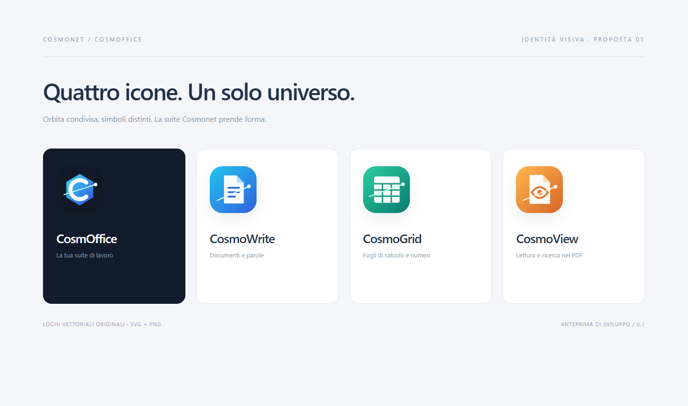

# CosmOffice

Suite desktop offline Cosmonet: **CosmoWrite**, **CosmoGrid** e **CosmoView**.

**Stato: anteprima 0.1.0.** È una prima implementazione funzionante, con un sottoinsieme delle funzioni Office. Non è ancora un sostituto completo di Microsoft Office. Android e iOS sono pianificati, non implementati.



## Cosa funziona

- CosmoWrite: scrittura e modifica, titoli, grassetto, corsivo, sottolineato, barrato, allineamento, elenchi, tabelle, immagini locali, annulla/ripristina; importazione DOCX/TXT/HTML ed esportazione DOCX; stampa tramite il sistema.
- CosmoGrid: importazione ed esportazione XLSX, più fogli, modifica celle, grassetto e formati numerici essenziali, formule aritmetiche e riferimenti allo stesso foglio, SUM/SOMMA, AVERAGE/MEDIA, MIN, MAX, COUNT/CONTA.NUMERI, IF/SE, ROUND/ARROTONDA e ABS/ASS.
- CosmoView: apertura PDF offline, pagine, zoom, rotazione, selezione testo, ricerca per pagine, password e salvataggio di una copia identica all’originale. Non esegue script o azioni dei documenti.
- Bozze e file PDF conservati localmente in IndexedDB, riapertura dall’archivio, ricerca, rinomina ed eliminazione delle copie locali.
- File originali conservati: l’esportazione chiede dove salvare la copia.
- Nessun account, nessun CDN, nessuna telemetria; font e decoder PDF sono inclusi nel pacchetto.

## Compatibilità: limiti espliciti

L’importazione Word ricostruisce il contenuto; non riproduce fedelmente paginazione, stili complessi, intestazioni/piè di pagina, commenti, revisioni o tutti gli oggetti incorporati. Esportare e confrontare sempre una copia per documenti importanti. L’immagine esportata può richiedere aggiustamenti dimensionali; WebP non è ancora esportato in DOCX.

I fogli preservano i dati fuori dall’area visibile, ma non garantiscono la conservazione di ogni oggetto Excel. Macro, grafici, pivot, formule tra fogli/cartelle, funzioni avanzate, formati DOC/XLS/XLSM, selezioni multiple, incolla di intervalli e fogli enormi non sono supportati in questa anteprima. Le formule non riconosciute mostrano un errore e non usano risultati memorizzati obsoleti. Excel è invitato a ricalcolare le formule all’apertura.

Il visualizzatore PDF non modifica i PDF, non esegue OCR su scansioni e non offre ancora firma, annotazioni o compilazione moduli. La ricerca trova le pagine che contengono il testo. La stampa completa PDF è prevista in una fase successiva.

Le bozze locali non sostituiscono un backup. L’apertura dei file è limitata a 50 MB. L’interfaccia si adatta anche a schermi stretti; ciò non equivale a un’app Android/iOS.

## Avvio locale

Richiede Node.js 24 e npm.

```sh
npm ci
npm run icons
node scripts/pdf-assets.mjs
npm run dev
```

Per usare solo l’anteprima nel browser: `npm run dev:web`. Gli editor non richiedono un server dopo l’installazione desktop: i file dell’app vengono caricati dal pacchetto locale.

```sh
npm test
npm run build
npm run test:browser
npm run dist
```

I test browser usano Chrome installato. In CI si usa Chromium di Playwright (`COSMO_BROWSER=chromium` dopo `npx playwright install chromium`).

## GitHub Actions

Ogni push su `main` avvia test e crea gli installer di anteprima per Windows x64, Linux x64 e macOS Intel/Apple Silicon. Gli artefatti sono nella scheda **Actions**, disponibili per 14 giorni. Le build di anteprima non sono firmate e non attivano l’aggiornamento automatico.

Il workflow per tag `v*` controlla la versione, richiede le credenziali di firma per Windows/macOS e carica una **release in bozza**. Pubblicandola, i pacchetti di release possono controllare e scaricare aggiornamenti da GitHub. Il riavvio per installare avviene su richiesta dell’utente dopo il salvataggio delle bozze. Su Linux l’aggiornamento automatico riguarda AppImage; per DEB si installa il pacchetto aggiornato. Il flusso end-to-end richiede repository pubblico, certificati e almeno due versioni pubblicate; non è ancora collaudato.

Segreti necessari per le release:

| Piattaforma | Segreti |
| --- | --- |
| Windows | `WIN_CSC_LINK`, `WIN_CSC_KEY_PASSWORD`, `WIN_PUBLISHER_NAME` |
| macOS | `MAC_CSC_LINK`, `MAC_CSC_KEY_PASSWORD`, `APPLE_ID`, `APPLE_APP_SPECIFIC_PASSWORD`, `APPLE_TEAM_ID` |

Non aggiungere chiavi o certificati al repository. Il progetto non contiene credenziali.

## Schermate

- [Pagina iniziale](docs/preview/01-cosmoffice.png)
- [CosmoWrite](docs/preview/02-cosmowrite.png)
- [CosmoGrid](docs/preview/03-cosmogrid.png)
- [CosmoView PDF](docs/preview/05-cosmoview.png)

## Componenti e marchio

Interfaccia e loghi vettoriali sono stati creati per Cosmonet. Il logo CosmoNet originale è un materiale fornito nel workspace. I componenti di terze parti mantengono le loro licenze; `node scripts/notices.mjs` genera le attribuzioni distribuite nel pacchetto. Il codice e il marchio proprietari restano riservati a Cosmonet, salvo successiva scelta esplicita del titolare.

## Sviluppo successivo

1. Collaudo di documenti reali e installer su tutte le piattaforme desktop.
2. Espansione del motore di calcolo e della fedeltà DOCX/XLSX; valutazione di un motore Office completo per le funzioni avanzate.
3. Selezioni e operazioni su intervalli, gestione completa fogli, grafici, stampa e PDF avanzati.
4. Firma, notarizzazione e prova reale dell’aggiornamento da una release alla successiva.
5. App Android/iOS con accesso ai file nativo, store e aggiornamenti previsti dalle piattaforme.
